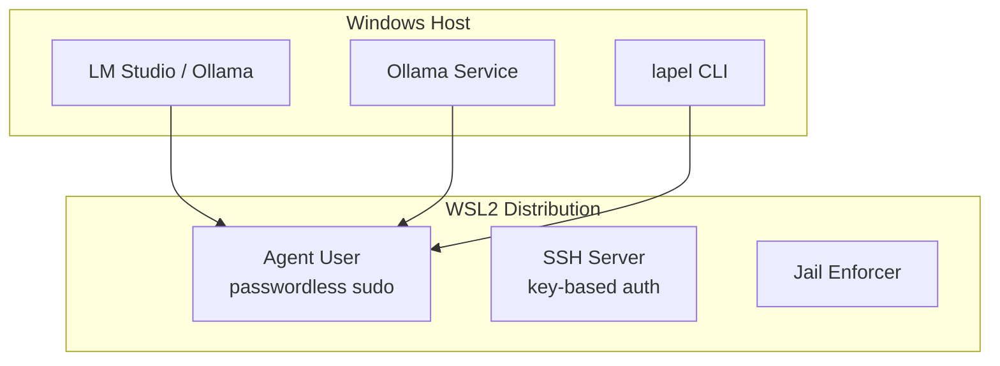

# lapel features

## The three pillars

lapel solves three specific problems for power users running coding agents with local AI:

### 1. Provider reachability 🥇

Your inference server (LM Studio, Ollama) lives on Windows. Your agent lives in WSL. lapel verifies the connection from the *Linux side*, where it actually matters.

- **Provider detection**: Identifies installed providers on your Windows host
- **Runtime status**: Shows running state, port, bind address, loaded models
- **Connectivity verification**: Probes endpoints from WSL and classifies errors (connection-refused vs timeout vs auth failure)
- **Model listing**: Queries available models via provider APIs
- **NAT gateway discovery**: Resolves the Windows host IP from `/proc/net/route`, not the lying `resolv.conf`

```bash
lapel doctor              # verify prerequisites
lapel provider detect     # find installed providers
lapel provider status     # runtime state for all providers
lapel provider reachability   # probe from inside WSL
lapel provider model-list --provider ollama
```

**Supported providers:**

| Provider | Detection method | Notes |
|----------|-----------------|-------|
| **LM Studio** | `lms` CLI + system tray | Preferred; GUI + CLI (`lms server start/stop/status`) |
| **Ollama** | API on `localhost:11434` | Lightweight; background service |

### 2. Lean environment 🥈

Stock Ubuntu from the Store is a general-purpose OS living inside Windows — systemd services, background daemons, full PATH with `/mnt/c`, GUI apps. When your inference server is also running on this machine, every MB of RAM and percent of CPU that WSL wastes is taken from your model.

A purpose-built minimal distro is a feature, not a limitation:

- **Automatic provisioning**: Imports a fresh Ubuntu/Debian rootfs with checksum verification
- **Idempotent package management**: Installs only what agents need (git, curl, tmux, ripgrep, sshd)
- **SSH ready**: Configures key-based authentication automatically
- **PATH filtering**: Strips `/mnt/c`, `/mnt/d` from PATH to prevent host tool leakage
- **Resource-conscious by design**: No GUI apps (`guiApplications=false`), minimal daemons

```bash
lapel env status          # inspect runtime state
lapel provision           # build the agent-optimized baseline
```

### 3. Agent sandboxing 🥉

Filesystem scoping, network restrictions, process timeouts. Your agent gets read-write access to your projects, deny access to System32, and runs as a non-root user.

- **Filesystem scoping**: Grant read-write, read-only, or deny access to Windows paths
- **Network restrictions**: Choose between unrestricted, outbound-only, or no network
- **Process timeouts**: Kill long-running processes after a configured duration
- **Resource limits**: Cap memory and CPU per session
- **Honest enforcement reporting**: Distinguishes *requested* vs *enforced* vs *unsupported* — never silently ignored or overclaimed

```bash
lapel apply               # enforce jail policies from manifest
lapel status              # check enforcement is active
```

---

## User journey

```
doctor → setup → run
              ↘ troubleshoot
```

| Step | Command | What happens |
|------|---------|--------------|
| **Doctor** | `lapel doctor` | Verifies WSL availability, provider reachability, hardware detection (planned) |
| **Setup** | `lapel setup` | One command: provision environment, import workspace, apply jail policies *(coming soon)* |
| **Run** | `lapel run` | Launch agent session with everything configured *(coming soon)* |
| **Troubleshoot** | `lapel status` / `lapel provider reachability` | Check what's actually running and where things might be broken |

---

## Power user escape hatch: declarative configuration

For users who want more control, lapel supports a YAML manifest with drift detection and transactional apply/rollback. This is an escape hatch — the guided setup handles defaults well.

```bash
lapel init                # scaffold lapel.yaml in current dir
lapel plan                # preview changes (non-zero exit on drift)
lapel apply               # persist baseline + import workspace
lapel status              # compare live state against baseline over time
```

**What's under the hood:**

- **Manifest schema**: Single `lapel.yaml` describes desired state for distro, packages, jail, workspace, provider, agent
- **SQLite state store**: Persists the desired-state baseline per-project (in `.lapel/state.db`)
- **Reconcile engine**: Detects drift between live reality and manifest, reports with actionable hints
- **Transaction safety**: Partial failures roll back atomically

---

## Configuration reference

### Manifest schema (`lapel.yaml`)

```yaml
schemaVersion: 1

distro:
  name: Ubuntu-Lean
  base: ubuntu          # "ubuntu" | "debian"; defaults to "ubuntu"
  version: "24.04"      # pinned release; auto-selected default when omitted
  defaultUser: kurt     # WSL default user (defaults to $USER)
  systemd: true         # enables [boot] systemd=true in wsl.conf

packages:
  baseline: []          # nil = use built-in agent toolkit (~16 packages)
  extras:               # additional packages beyond baseline
    - ripgrep
    - fd-find
    - tree

jail:
  name: developer
  user: kurt            # defaults to distro.defaultUser
  filesystem:
    "C:\\Users\\Kurt\\Projects": read-write
    "C:\\Windows\\System32": deny
  network: unrestricted # "unrestricted" | "outbound-only" | "none"
  processes:
    privileged: false   # agent runs as non-root by default
    timeoutSeconds: 300 # kill long-running processes after 5 min

workspace:
  path: "."             # Windows path to import into WSL
  importMode: copy      # "copy" (rsync) | "bind" (bind mount)

env:
  TERM: xterm-256color
  LANG: en_US.UTF-8
```

### Package management

lapel maintains a minimal baseline package set optimized for agent workloads. The default baseline includes: git, curl, wget, ca-certificates, gnupg, unzip, zip, tmux, xxd, procps, iproute2, openssh-server, and more (~16 packages).

- **Baseline**: Override with `packages.baseline: []` to use defaults, or supply your own list
- **Extras**: Add anything beyond the baseline with `packages.extras`
- **Idempotent**: Only installs packages that aren't already present

---

## Planned features

| Feature | Status | Notes |
|---------|--------|-------|
| **Hardware detection** | Planned | Detect GPU VRAM, RAM, CPU cores; recommend model tier based on hardware |
| **Model recommendations** | Planned | "You have 12GB VRAM → try Q4_K_M Mistral 7B" — turns `doctor` into an onboarding advisor |
| **Agent presets** | Planned | Pre-configured setups for Pi (lean), Claude Code (balanced), Copilot-style (full tooling) |
| **Community setups** | Deferred | Collect anonymized configs to help new users avoid the "which model/settings" rabbit hole |
| **LM Studio management** | Deferred | lapel as another llama.cpp wrapper — manage model downloads, serving, VRAM optimization from within lapel |

---

## Architecture overview



### Key design decisions

- **Minimal distro**: Only essential packages installed; on-demand installation for extras. This is a feature — more resources for your model.
- **Passwordless sudo for `agent` user**: Restricted to specific commands (`apt-get`, `systemctl`, `useradd`, etc.) for security
- **NAT networking**: Verified working with mirrored mode issues in WSL 3.0.x
- **Process lifecycle**: Launch → Track → Stop → Verify (no orphans)
- **Honest enforcement reporting**: Distinguishes requested vs enforced vs unsupported controls

---

## Getting started

```bash
# 1. Check prerequisites and provider reachability
lapel doctor

# 2. Provision a lean WSL environment
lapel provision

# 3. Verify your provider is reachable from inside WSL
lapel provider reachability

# 4. (Optional) Create a manifest for custom jail policies
lapel init
lapel apply

# 5. Run your agent (when ready)
lapel run
```

For detailed usage, see the [README.md](../README.md) or run `lapel --help`.
