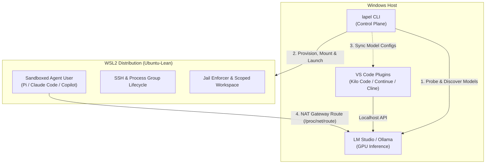

# lapel features

## Overview

`lapel` bridges Windows GPU inference providers (LM Studio, Ollama) with coding agents running in WSL2 and VS Code across four pillars:

1. **Provider reachability** — Verify and route WSL-to-Windows inference connections reliably.
2. **Lean WSL2 environment** — Provision a minimal `Ubuntu-Lean` distro so your RAM goes to your model's KV cache, not background desktop services.
3. **Agent sandboxing** — Scope filesystem access, strip host `PATH` leakage, and report enforcement status honestly.
4. **Hardware-aware config sync & tuning** — Detect GPU/VRAM specs, recommend model tiers and context windows, and sync configurations across CLI agents and IDE plugins.

---

### 1. Provider reachability 🥇

Your inference server (LM Studio, Ollama) lives on Windows. Your CLI agent lives in WSL. `lapel` verifies the connection from the *Linux side*, where it actually matters.

- **Provider detection**: Identifies installed providers on your Windows host
- **Runtime status**: Shows running state, port, bind address, and loaded models
- **NAT gateway discovery**: Resolves the real Windows host IP from `/proc/net/route` (not the unreliable WSL `resolv.conf`)
- **Connectivity verification**: Probes endpoints from inside WSL and classifies errors (connection-refused vs. timeout vs. HTTP error)
- **Model listing**: Queries available models via provider APIs

```bash
lapel doctor                        # verify prerequisites, hardware & reachability
lapel provider detect               # find installed providers on Windows host
lapel provider status               # runtime state and loaded models for all providers
lapel provider reachability         # probe Windows host endpoint from inside WSL
lapel provider model-list --provider lm-studio
```

**Supported providers:**

| Provider | Detection method | Notes |
|----------|-----------------|-------|
| **LM Studio** | `lms` CLI + HTTP probe (`:1234`) | Preferred; GUI + CLI (`lms server start/stop/status`) |
| **Ollama** | HTTP API on `:11434` | Lightweight background service |

---

### 2. Lean environment (`Ubuntu-Lean`) 🥈

Stock Ubuntu from the Microsoft Store is a general-purpose OS living inside Windows — systemd services, background daemons, full `PATH` with `/mnt/c`, and GUI apps. When your inference server is also running on the same machine, every MB of RAM and percent of CPU that WSL wastes is taken directly from your model.

A purpose-built minimal distro is a feature, not a limitation:

- **Automatic provisioning**: Imports a fresh Ubuntu/Debian rootfs with checksum verification
- **Idempotent package management**: Installs only what coding agents need (`git`, `curl`, `tmux`, `ripgrep`, `sshd`, `procps`, `iproute2`, etc.)
- **SSH ready**: Configures key-based authentication automatically
- **PATH filtering**: Strips `/mnt/c` and `/mnt/d` from `PATH` to prevent Windows host tool leakage
- **Resource-conscious by design**: No GUI apps (`guiApplications=false`), minimal background services, `.wslconfig` cap inspection (`lapel config`)

```bash
lapel env status          # inspect registered distro runtime state
lapel config              # inspect host .wslconfig memory/CPU caps and networking warnings
lapel provision           # build the agent-optimized Ubuntu-Lean baseline (idempotent)
```

---

### 3. Agent sandboxing & honest reporting 🥉

Filesystem scoping, network rules, and process timeouts so your coding agent can work in your project workspace without risking your Windows system files.

- **Filesystem scoping**: Configure `read-write`, `read-only`, or `deny` access to paths
- **Workspace import modes**: Live `bind` mounts for rapid development or isolated `copy` (`rsync`) snapshots
- **Process lifecycle & timeouts**: Runs sessions in dedicated process groups (`setsid`) with verified guest-side teardown (`lapel session smoke`) so no orphaned processes survive
- **Honest enforcement reporting**: Explicitly distinguishes `enforced` vs. `requested` vs. `unsupported` vs. `needs-config` controls (`lapel jail-controls`) — never silently ignored or overclaimed

```bash
lapel apply               # persist desired baseline & import workspace
lapel status              # check live state and drift against baseline
lapel session smoke       # verify session launch, teardown, and zero orphaned processes
```

---

### 4. Hardware-aware tuning & agent/IDE config sync ⚡

Stop guessing which model quantization, context window, or batch size fits your GPU, and stop hand-editing JSON files every time you load a new model.

- **Local hardware detection**: Inspects GPU model, VRAM capacity, CUDA/driver versions, system RAM, and CPU cores (`lapel doctor`, `lapel setup`)
- **Model tier advisor**: Recommends model parameter tiers and quantizations tailored to your available VRAM
- **CLI agent launcher (`lapel run`)**: Auto-detects installed CLI agents (**Pi**, **Claude Code**, **GitHub Copilot CLI**) and launches them inside WSL wired to your active Windows inference provider
- **VS Code plugin sync *(in progress)***: Generates and syncs model configurations with VRAM-sized context windows for **Kilo Code**, **Continue**, and **Cline**
- **Verified community tuning profiles *(opt-in)***: Query crowd-verified batch sizes, context limits, and agent compaction settings (`lapel community insights`) or share measured benchmarks (`lapel community share`)

---

## Core user journey

```
doctor → setup → run
              ↘ troubleshoot (status / provider reachability / config)
```

| Step | Command | What happens |
|------|---------|--------------|
| **1. Doctor** | `lapel doctor` | Checks WSL2 availability, kernel/GPU status, hardware specs, and model tier recommendation |
| **2. Setup** | `lapel setup` | One command: checks providers, provisions `Ubuntu-Lean`, imports workspace, and configures jail |
| **3. Run** | `lapel run` | Detects your installed coding agent, wires it to your active provider, and launches a sandboxed session |
| **Troubleshoot** | `lapel status` / `lapel provider reachability` | Inspects drift against baseline and classifies WSL-to-Windows networking issues |

---

## Declarative configuration (`init` / `plan` / `apply` / `status`)

For power users and teams who want reproducible configuration management, `lapel` supports a `lapel.yaml` manifest with SQLite-backed drift detection:

```bash
lapel init                # scaffold lapel.yaml in current directory
lapel plan                # preview drift between live state and lapel.yaml (non-zero exit on drift)
lapel apply               # persist baseline to .lapel/state.db + import workspace
lapel status              # compare live state against persisted baseline over time
```

### Manifest schema (`lapel.yaml`)

```yaml
apiVersion: lapel.dev/v1
name: lapel-project

environment:
  distribution: Ubuntu-Lean
  base: ubuntu          # "ubuntu" | "debian"; defaults to "ubuntu"
  version: "24.04"      # pinned release; auto-selected default when omitted
  packages:             # additional apt packages beyond the built-in agent toolkit
    - ripgrep
    - fd-find
    - tree

provider:
  name: local
  type: lm-studio       # "lm-studio" | "ollama" | "openai-compatible"
  baseURL: "http://127.0.0.1:1234"
  connectionTimeout: 8s

agent:
  name: pi              # "pi" | "claude-code" | "copilot"
  provider: local

workspace:
  name: workspace
  path: "."             # Windows path to import into WSL
  importMode: bind      # "bind" (bind mount) | "copy" (rsync snapshot)

jail:
  name: developer
  profile: developer
  user: agent           # Linux user for agent sessions
  filesystem:
    "C:\\Users\\user\\Projects": read-write
    "C:\\Windows\\System32": deny
  network: unrestricted # "unrestricted" | "outbound-only" | "none"
  processes:
    privileged: false   # agent runs as non-root by default
    timeoutSeconds: 300 # kill long-running processes after 5 min
```

---

## Architecture overview


